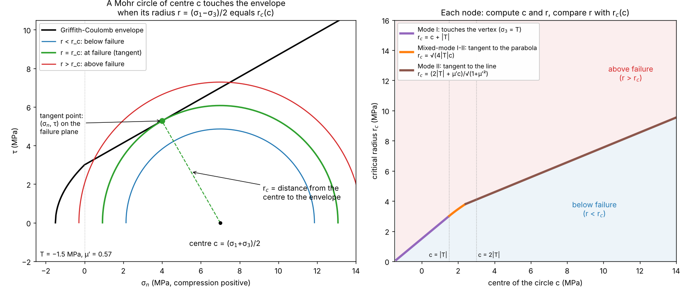
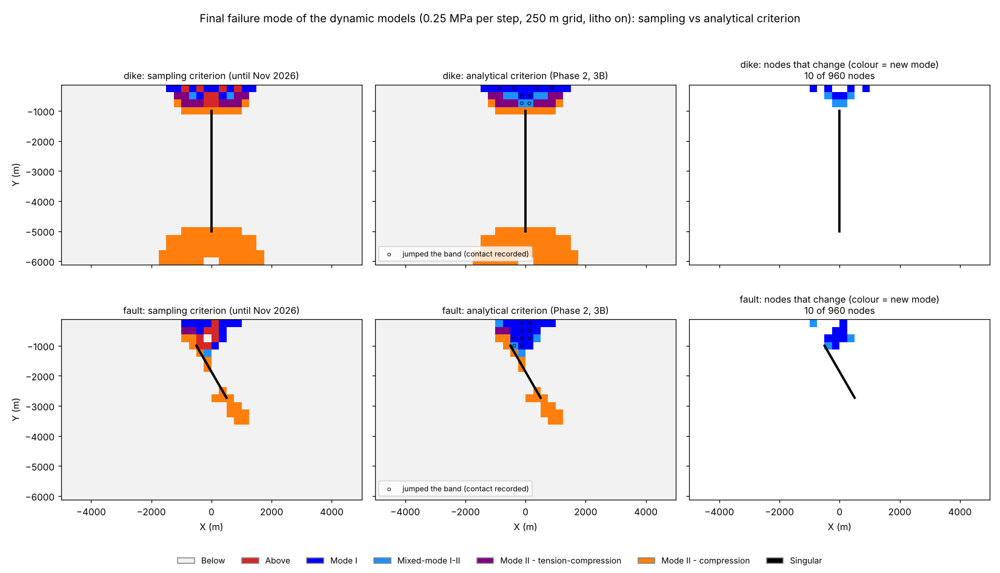

# The failure criterion of DiES: analytical Griffith-Coulomb tangency

_Phase 2, point 3B (Nov 2026), branch `phase2-analytic-failure`. Replaces the sampling
algorithm used until then, which is kept as `evaluate_stress_state_sampling` for comparison._

## 1. Summary

DiES decides whether a state of stress fails, and how, by comparing its Mohr circle with the
Griffith-Coulomb envelope. Since Nov 2026 this is done analytically:

> A Mohr circle of centre c touches the envelope exactly when its radius equals the
> **distance from its centre to the envelope**. That distance is the **critical radius r_c**,
> and it depends only on c, T and μ′.

For each node: compute c and r, compute r_c(c), and compare. The point of the envelope closest
to the centre is where the circle touches it: it gives the stresses on the failure plane, the
angle 2θ and the failure mode. Nothing is sampled, every node of a grid is evaluated at once,
and the dynamic models run about 30 times faster.

_Left: three circles with the same centre; the green one, of radius r_c, is tangent to the
envelope. Right: r_c as a function of the centre, coloured by the part of the envelope it
touches, which decides the failure mode. T = −1.5 MPa, μ′ = 0.57. Script:
`docs/figures/critical_radius.py`._

## 2. Conventions and the envelope

Mohr diagram in MPa, **compression positive**: σn on the horizontal axis, τ on the vertical one.
p = σ1 and s = σ3 are the maximum and minimum compressive principal stresses (p ≥ s). The
tensile strength T is negative (e.g. −1.5 MPa); write k = |T|. The cohesion is not an input: it
is implicitly 2k.

- **Mohr circle:** centre c = (p + s)/2, radius r = (p − s)/2.
- **Griffith parabola** (tension side, −k ≤ σn < 0): τ² = 4k(σn + k). Vertex at (−k, 0) = (T, 0).
- **Coulomb line** (σn ≥ 0): τ = 2k + μ′σn, with μ′ the coefficient of internal friction (`cfi`).
- The two meet at (0, 2k). The envelope has a kink there: the parabola arrives with slope 1 and
  the line leaves with slope μ′.

## 3. The critical radius

r_c(c) is the distance from the centre (c, 0) to the envelope, i.e. the smaller of the distances
to the parabola and to the line. Each one has a closed form.

### 3.1 Distance to the Griffith parabola

Substituting τ² = 4k(σn + k) into the equation of the circle, (σn − c)² + τ² = r²:

    σn² − 2(c − 2k)·σn + (c² + 4k² − r²) = 0

The circle is tangent to the parabola when this quadratic has a double root, i.e. when its
discriminant is zero:

    (c − 2k)² − (c² + 4k² − r²) = 0   ⇒   r² = 4kc

So **r_c = √(4kc)**, and the tangent point is the double root, **σn = c − 2k**, with
τ = √(4k(σn + k)). This holds while that point is on the parabola, −k ≤ c − 2k ≤ 0, i.e.
**k ≤ c ≤ 2k**. Otherwise the closest point is an end of the parabola:

- **c < k:** the vertex (−k, 0). **r_c = c + k**: the circle touches the envelope at σ3 = T.
  This is **Mode I**. It is the classical Griffith result: pure tensile failure (σ3 = −T0)
  happens only when σ1 + 3σ3 < 0 (tension negative), which in terms of the circle is c < k.
- **c > 2k:** the end (0, 2k), r_c = √(c² + 4k²) (in practice the line is closer there).

### 3.2 Distance to the Coulomb line

Distance from the point (c, 0) to the line μ′σn − τ + 2k = 0:

    r_c = (2k + μ′c) / √(1 + μ′²)

The tangent point is the foot of the perpendicular from the centre,
**σn = c − r_c·μ′/√(1 + μ′²)**, τ = 2k + μ′σn. This holds while σn ≥ 0; otherwise the closest
point of the line is its end (0, 2k).

At the tangent point the radius is perpendicular to the line, so 2θ = 90° + φ with tan φ = μ′:
the classical Coulomb angle (119.68° for μ′ = 0.57).

### 3.3 The contact

    r_c = min(distance to the parabola, distance to the line)

- The **contact point** (σn, τ) is the closest point of the envelope.
- **2θ** is the angle at the centre from σ1 (the point (p, 0)) to the contact point:
  2θ = atan2(τ, σn − c), in degrees. It is 180° for Mode I. θ is the angle between σ1 and the
  normal to the failure plane (as before; see `failure_plane_orientation`).
- **Mode:**

| The circle touches… | Mode |
|---|---|
| the vertex (c < k) | `'Mode I'` |
| the parabola (k ≤ c and the parabola is closer) | `'Mixed-mode I-II'` |
| the line, or the kink, with σ3 < 0 | `'Mode II - tension-compression'` |
| the line, or the kink, with σ3 ≥ 0 | `'Mode II - compression'` |

With T = −1.5 MPa and μ′ = 0.57 the parabola is closer only for c between 1.5 and ~2.4 MPa;
from there on the line is.

If the centre is at or beyond the vertex (c ≤ T), r_c ≤ 0: any circle is beyond failure.

Code: `failure_contact(p, s, cfi, T)` in `Failure_Determination.py` returns r/r_c, the contact
point, 2θ and the mode of the contact, for numbers or arrays.

## 4. Classification of a state of stress

With the ratio r/r_c (`evaluate_stress_state`, `evaluate_stress_states`):

| Condition | Result |
|---|---|
| p or s not finite (node on a crack tip) | `'Singular'` |
| p = s (isotropic: the circle is a point) | `'Below'` if p > T, `'Above'` otherwise |
| s < T (σ3 beyond the tensile strength) | `'Above'` |
| r/r_c > 1 + `FAILURE_TOLERANCE` | `'Above'` |
| \|r/r_c − 1\| ≤ `FAILURE_TOLERANCE` | **at failure**: the mode of the contact |
| r/r_c < 1 − `FAILURE_TOLERANCE` | `'Below'` |

- **`FAILURE_TOLERANCE = 0.035`** (a constant of `Failure_Determination.py`). A circle is taken
  to be at failure within ±3.5 % of the critical radius. This reproduces the band of the
  sampling algorithm, measured with T = −1.5 MPa and μ′ = 0.57 (Section 6.2): from about
  r/r_c = 0.965 to 1.035, ending at 1.00 near the vertex because there a slightly larger circle
  already has s < T.
- **Stresses on the failure plane** (`sn`, `ss`): the point of the circle in the direction 2θ
  of the contact, σn = c + r·cos 2θ and τ = r·sin 2θ. At r = r_c it is the contact point; within
  the band it is the stress actually acting on that plane (as the sampling algorithm gave).
- `sn`, `ss` and 2θ are NaN unless the state is at failure.
- p < s at a node with finite stresses, or T ≥ 0, raise `InputError`.

## 5. Dynamic models: nodes that jump over the band

In `compute_dynamic_model` the driving stresses grow step by step and the first failure of each
node is kept in all the following steps. If a step is large enough, a node can go from
`'Below'` to `'Above'` without ever being inside the band. Until Nov 2026 such a node stayed
`'Above'`, without mode or plane.

Since point 3B (Sam's decision of 25 Nov 2026) it keeps the **mode, the stresses and the plane
of the contact point** of its circle at that step, and the field **`failure_jumped`** is 1 there
(0 elsewhere). For these nodes `sn` and `ss` are the contact point on the envelope, the best
estimate of the stresses on the plane at the moment of failure.

To tell a node that jumped from one that was already beyond failure before the crack was loaded
(e.g. by the remote stresses), the modes of the unloaded state (driving stresses 0) are computed
first and used as the "previous step" of step 1.

Many jumped nodes mean that the steps are too large for the grid: reduce the step to resolve
the failure sequence. The metadata of the run record `failure_criterion = 'analytical'` and
`failure_tolerance`.

## 6. Differences from the sampling algorithm (until Nov 2026)

The sampling algorithm (`evaluate_stress_state_sampling`, logic unchanged) took `int(r)·50`
points of the circle and looked for points where the tangent to the circle matched the tangent
to the parabola or the line within 5 % in slope and intercept, averaging the matches. It checked
first whether σ3 was beyond T (`'Above'`), then whether it was within 5 % of T (Mode I branch).

### 6.1 Changes decided by Sam (25 Nov 2026)

1. **Mode I only at the vertex.** For centres between k and 2k the critical circle has
   σ3 = c − √(4kc), very close to T (e.g. −1.43 MPa for c = 2.2), so the sampling algorithm took
   its Mode I branch and returned σn = T, τ = 0. The tangency is on the parabola, away from the
   vertex: the analytical criterion returns `'Mixed-mode I-II'` (for c = 2.2: σn = −0.80,
   τ = 2.05 MPa) and the plane changes accordingly.
2. **The band is explicit:** `FAILURE_TOLERANCE` (Section 4).
3. **Nodes that jump over the band** keep the contact (Section 5).

### 6.2 Band of the sampling algorithm (measured on 25 Nov 2026)

Circles of centre c and radius q·r_c, q from 0.90 to 1.10 in steps of 0.002, T = −1.5 MPa,
μ′ = 0.57. Range of q classified as failure by the sampling algorithm:

| c (MPa) | 0.3 | 0.8 | 1.6 | 2.0 | 2.4 | 3.0 | 4 | 6 | 12 | 25 |
|---|---|---|---|---|---|---|---|---|---|---|
| q from | 0.960 | 0.968 | 0.970 | 0.966 | 0.962 | 0.962 | 0.964 | 0.964 | 0.966 | 0.962 |
| q to | 1.000 | 1.000 | 1.000 | 1.002 | 1.006 | 1.062 | 1.034 | 1.034 | 1.030 | 1.032 |

### 6.3 Bugs of the sampling algorithm that disappear

- **Crash at σn = 0:** when a sample fell exactly on σn = 0 (e.g. σ3 = 0, or `linspace` through
  0), neither the Griffith check (σn < 0) nor the Coulomb one (σn > 0) took it, no branch
  assigned the results, and it raised `UnboundLocalError` (77 of the 2993 states of the
  regression sweep). It stopped the model; it did not give wrong results.
- **Small circles were always `'Below'`:** with r < 1 MPa, `int(r)·50` is 0, so no point was
  sampled and the state was `'Below'`, whatever it was: e.g. σ1 = −2.3 and σ3 = −4 MPa (biaxial
  tension beyond T = −1.5 MPa). This one is silent: it may affect earlier results where small
  circles in tension occur (e.g. near the surface).
- **Averages across the kink:** near σn = 0 the matches were found on both sides of the kink
  and averaged: σn ≈ 0 and 2θ up to 13° away from the Coulomb angle (e.g. 131° instead of
  119.68°), and the mode decided by the sign of that average.

### 6.4 Comparison

- **Sweep of 2993 states** (`tests/regression_cases.py`): 2328 `'Below'` and 374 `'Above'` agree;
  Mode II states found by both agree in σn and τ within ~2 % of the radius (the resolution of the
  sampling average) away from the kink; next to it (c ≈ 2.5–2.9 MPa) they differ by up to
  0.76 MPa and 13° in 2θ, the averaging error of Section 6.3. The rest are the changes above:
  Mode I → mixed mode, band edges, the 77 crashes (now classified) and the small circles.
- **Dynamic models** (dike with opening only and 60° fault with σII = 15 MPa, 0.25 MPa per step,
  250 m grid, litho on): 10 of 960 nodes change in each, all near the surface. Most are nodes that
  the sampling algorithm left `'Above'` because they jumped the band and that now record Mode I or
  mixed mode; 2 per model change from Mode I to mixed mode. Of the nodes that fail with both, the
  first-failure step is the same or one step (0.25 MPa) apart, except one node of the fault.
- **Speed:** 29 s → 1.1 s (dike, 32 steps) and 48 s → 1.6 s (fault, 60 steps).

_Script: `docs/figures/failure_criterion_comparison.py` (runs commit `4adce9e` in a temporary
git worktree and the current code)._

## 7. Where it is in the code

| Function (`Failure_Determination.py`) | What it does |
|---|---|
| `failure_contact(p, s, cfi, T)` | r/r_c, contact point, 2θ and mode of the contact (Section 3). Numbers or arrays. |
| `evaluate_stress_states(p, s, cfi, T)` | Classification of every node (Section 4); arrays. |
| `evaluate_stress_state(p, s, cfi, T, output)` | One state (`'values'` or `'plot'`), or arrays with `'values'`. |
| `FAILURE_TOLERANCE` | Half-width of the band of r/r_c (0.035). |
| `evaluate_stress_state_sampling(p, s, cfi, T)` | The algorithm used until Nov 2026, for comparison. |
| `failure_plane_orientation(s1a, theta, mode, side)` | Orientation of the failure plane (unchanged). |

`compute_dynamic_model` (`Modeling_functions.py`) uses `evaluate_stress_states` for every step,
and `failure_contact` for the nodes that jump over the band.

Tests: `tests/test_failure_criterion.py` (tangency, modes by zone, band, the old bugs, agreement
with the sampling algorithm on the Coulomb line, nodes that jump the band).
